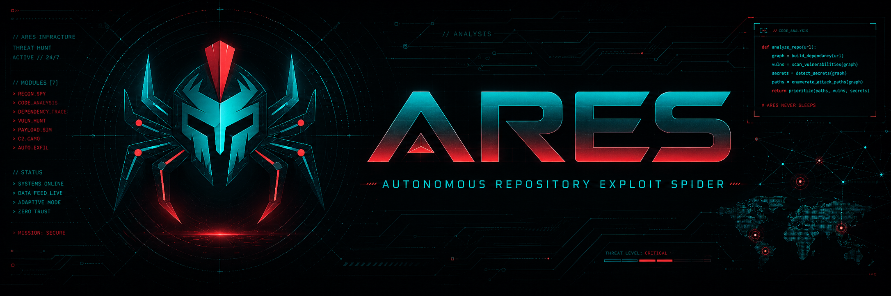

## ARES, the Zeroday Machine: From Target to CVE, Autonomously

  

## Code Release Status
The full source code, deployment guides, and technical documentation will be released here following [our upcoming presentation](https://www.blackhat-india.com/briefings-schedule#ares-the-zeroday-machine-from-target-to-cve-autonomously-50004)

Please **stay tuned** for our official code release!

## Authors
- [DINH Thai Son (sondt)](https://github.com/sondt99)
- [NGUYEN Anh Quynh (aquynh)](https://github.com/aquynh)
